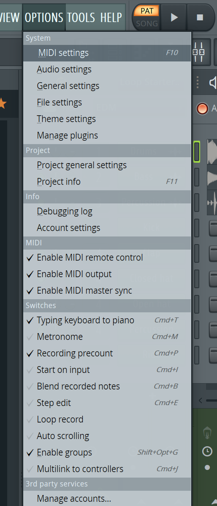
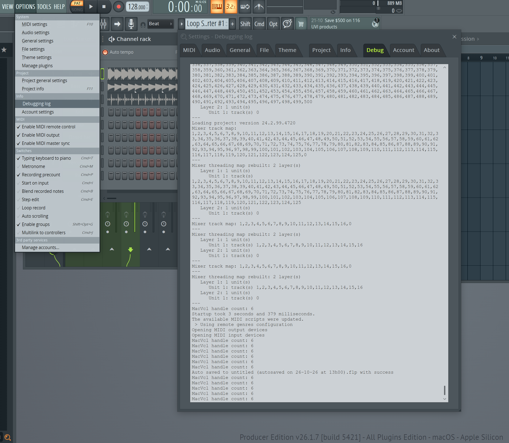

# maudio-oxygenpro-reason-flstudio README IN PROCESS - NOT YET READY

Maps in FL Studio 2026 the MIDI messages for transport control as tested on the M-Audio Oxygen Pro 49 set to REASON DAW Mode.

Transport control means like play, stop, forward, backward, loop, and record.

With various stock or out-of-the-box controller profiles in FL Studio 2026, the M-Audio Oxygen Pro 49 Play and Stop buttons do function as expected, mostly, when set to DAW mode FL Studio. **BUT** the other transport controls do not. Plus, generally speaking, it is nice to get as many control buttons mapped as possible and or to be able to customize them.

Kudos to Image-Line for many reasons, but for the case here, the kudos are for implementing a Python API! Way to go! For real. It adds a whole new level of operability and tool refinement.

*Use of AI Disclosure: Several conversations with Gemini, Gemini AI searches to get to links at Image-line, help with MIDI messages, and generated example code.*

## Inspiration & Acknowledgments

Inspired by the community scripts for the Oxygen Pro in FL Studio, this repository is a completely independent, open-source rewrite designed to implement a simple custom mapping profile targeting the Oxygen Pro 49 set to DAW REASON mode for use in FL Studio 2026 on Mac aka macos.

* [Official Image-Line MIDI Scripting API](https://www.image-line.com/fl-studio-learning/fl-studio-online-manual/html/midi_scripting.htm) - Image-Line's official python framework documentation
* [M-Audio Oxygen Pro Script by GratuiTous](https://itsgratuitous.com) - see Premium additional scripts and other FL Studio tutorials and books there too.
* [PotcFdk FL Studio 20 script for the OxyPro49](https://github.com/PotcFdk/FLStudioOxygenPro49) - see also DAW and user presets there as well.
* [Image-Line forum post about/by GratuiTous](https://forum.image-line.com/viewtopic.php?f=1994&t=253539)

## Configuration Tested

M-Audio Oxygen Pro 46 with FW: 2.1.2 (Nov 14th 2022, available from the M-Audio website as of this writing 10-26-26)

Mac: (Mini) Tahoe 26.5.2

FL Studio version: 26.1.7

## Installation

### The Device Itself: Oxygen Pro 49

Hold down the DAW button until you can edit the DAW selection.

Turn the selector knob under the little screen to select REASON, then click or exit or whatever to go back to playing.

But why? We're using FL Studio? Yep. It's weird. The REASON profile was somewhat arbitrary but by using the FL Studio => Options => Debugging log output you can see that this DAW profile on the OxyPro49 is what outputs usable control change messages for the transport control buttons. So, that's the profile to select to use with this script here. Change as you need.

### File Location

This script goes inside of a directory that you create and that lives inside of the hardware directory for Image-Line. For example, the path in this test scenario is:

`'/Users/my_user_name/Documents/Image-Line/FL Studio/Settings/Hardware/M-Audio-Oxygen-Pro-49'`

and then you put the script file in there. The directory name does not have to match anything in particular, nor does the script name. FL Studio will parse the directories on startup and will list the profiles by the name set in the script file itself to populate the controller profile selection list in the MIDI Options window.

### Settings

Navigate: FL Studio => Options => MIDI settings => Input tab (lower)

If your Oxygen Pro 49 is successfully connected by USB, there should be 4 entries for that device in the MIDI Input device section. The first device, maybe listed as Oxygen Pro 49 is how the note data gets transmitted to the program, FL Studio. You can leave it at (generic controller) or select from the drop-down in that section the Legacy => Oxygen Pro 49.

But the 3rd entry relating to the Oxygen Pro 49 is the one that handles the transport control messages. Directions used to otherwise suggest to set this to Mackie Control Universal or similar to get the transport messages working in FL Studio. But that seems no longer to be the case.

So, that is where you can select this script's name as the profile to use from the drop-down list for controller profiles.

In this script, the name is set to be `OXYGENPRO-XPORT-OBL`.

## Customization

You can edit the code as you see fit, following license guidelines, to change the name as listed in the controller profiles or to change which messages are handled and add more or change the screen output as needed, etc.

## License

GPLv3 accompanying, in this repo.

## Screenshots, Misc

